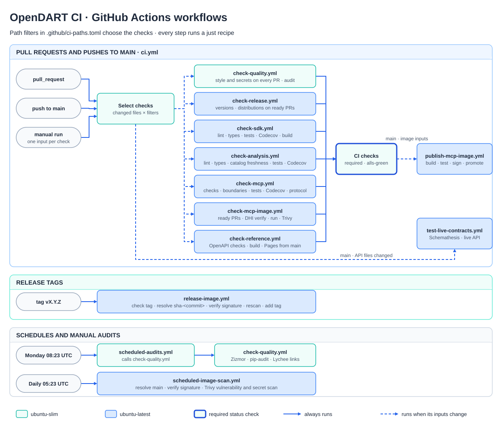

# GitHub automation

Pull requests and pushes to `main` start one workflow, [CI](workflows/ci.yml). Its first job
compares the change with its base, applies the filters in [ci-paths.toml](ci-paths.toml), and
calls only the check workflows whose inputs changed. The required **CI checks** job passes when
every selected check passes. Draft pull requests skip the image, distribution, and conformance
checks until they are marked ready. Analysis changes also select the MCP, image, and distribution
checks, because MCP and its image install analysis; SDK changes do not select analysis checks. The
analysis job installs neither the SDK nor MCP, and the MCP job, which installs all three packages,
runs the import-boundary check. Run `just ci plan` to preview the selection for local changes.

| Trigger | Workflow | Runs |
| --- | --- | --- |
| Pull request | [CI](workflows/ci.yml) | File, style, and secret checks always; audit, release, SDK, analysis, MCP, image, and reference checks when their inputs change |
| Push to `main` | [CI](workflows/ci.yml) | SDK, analysis, MCP, and reference checks for Codecov and Pages; publishes the image and tests live API contracts when their inputs change |
| Tag `vX.Y.Z` | [Release MCP image](workflows/release-image.yml) | Verifies, rescans, and tags the commit's published image |
| Monday 08:23 UTC | [Scheduled audits](workflows/scheduled-audits.yml) | Zizmor, pip-audit, and documentation links |
| Daily 05:23 UTC | [Scheduled image scan](workflows/scheduled-image-scan.yml) | Verifies and scans the published `main` image |

Manual runs: **CI** takes one input per check and never publishes, **Publish MCP image**
republishes `main`, **Release MCP image** retries a tag, and both scheduled workflows run on demand.

## Layout

- `workflows/check-*.yml`, `publish-mcp-image.yml`, and `test-live-contracts.yml` have no
  triggers of their own; CI and the scheduled workflows call them.
- `actions/setup` installs the pinned uv, Python, Node.js, Safe Chain, and locked dependencies.
  The other actions generate image labels, sign and verify images, and scan them with Trivy.
- `scripts/` holds the CI logic: change selection, Safe Chain and DHI verification, container
  checks, and image promotion. The selector's tests live in [tests/ci](../tests/ci).
- Steps run the same `just` recipes as local development.

Light jobs run on `ubuntu-slim`; Docker, parallel tests, and type checks use `ubuntu-latest`.
Renovate proposes dependency updates weekly ([renovate.json](../renovate.json)). The DHI registry
credentials that CI and Renovate need are described in the
[container guide](../packages/mcp/docs/CONTAINER.md#dhi-credentials).

Edit the diagram in [workflows.drawio](workflows.drawio), then export it as SVG with
**Include a copy of my diagram** to update [workflows.svg](workflows.svg).
