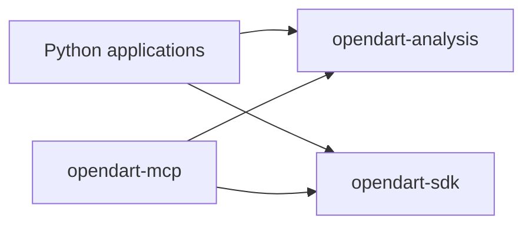

# SDK, analysis, and MCP reorganization plan

Status: implemented (2026-10-24). The plan below was verified against commit 79d5fa2 on 2026-10-23 and is kept as
written; the [outcome](#outcome) records where each capability ended up, deviations, and follow-ups.

Make OpenDART's company lookup, filing processing, and analytical workflows available to Python applications through
an installable library. Keep the SDK responsible for the upstream API contract and MCP responsible for its protocol,
presentation, and deployment. Implement the migration in small changes that preserve existing behavior.

The proposed third distribution is `opendart-analysis`, imported as `opendart_analysis`, in `packages/analysis/`.
Use the existing uv workspace, source layout, build backend, Python requirement, and coordinated release policy.

The SDK has 1,047 handwritten Python lines and MCP has 37,428, counting comments and docstrings and excluding generated
files. These measurements identify useful boundaries; they are not targets for how many lines must move. None of the
MCP subpackages below imports FastMCP, and none of `documents/`, `domain/`, or `events/` imports the SDK:

| MCP subpackage | Lines | Imports from MCP | Findings that affect the move |
| --- | --- | --- | --- |
| `documents/` | 5,832 | None | Depends on AnyIO and Pydantic and raises structured exceptions. MCP output schemas embed its models. `DocumentStore` runs on asyncio. |
| `domain/` | 3,303 | None | Depends on defusedxml. `resolver.py` builds model-facing messages that name MCP tools; `types.py` mixes display and business vocabulary. |
| `registry/` | 822, plus 4,071 generated | None | Imports the SDK only to annotate `sdk_method`, which binds a service to an SDK client method. |
| `events/` | 2,266 | `domain`, `registry` | Moves after both of its dependencies. |
| `services/` | 13,607 | `core`, `models`, `domain`, and others | Of 48 modules, 28 reference `AppState`, 39 import MCP output models, and 21 import MCP progress helpers. |

The SDK already supplies HTTP access, credentials, response validation, upstream errors, and redaction. Preserve that
reuse. The work is primarily about exposing existing functionality through a coherent library API.

Arrows in the proposed architecture mean "depends on":



Analysis and the SDK are independent. Analysis receives bytes, records, and callbacks, never an SDK client, so it
works with any data source and SDK regenerations do not affect it. MCP depends on both and owns the binding between
them: SDK clients, the gateway's caching and retries, and `sdk_method`. Applications that download with the SDK install
both. Declare each directly imported dependency in the package that imports it; the workspace must not conceal gaps.

A third distribution keeps each installation choice small. Moving this code into the SDK would mix interpretation,
caching, and background work into its raw API contract. Using MCP's internal modules as the library would require
FastMCP, MCP, and OpenTelemetry just to parse a filing. An SDK extra cannot help: extras add dependencies, not modules.

| Owner | Responsibilities after migration |
| --- | --- |
| `packages/sdk` | Generated endpoint methods and wire models; transport; authentication; upstream settings, errors, and redaction; small explicit endpoint conveniences when justified. |
| `packages/analysis` | Directory parsing and resolution; filing parsing and search; normalization; financial and event interpretation; reusable workflows over caller-supplied data access, and their explicit runtime policies. |
| `packages/mcp` | Tools, resources, prompts, Apps, elicitation, MCP tasks, HTTP middleware, output envelopes, tool rendering, component versions, server composition, and the binding of analysis to SDK clients. |
| `scripts/` | SDK and catalog generators; shared operation descriptions in `scripts/codegen/` only if step 8's optional consolidation happens. |
| `tests/support` | Framework-free fakes and test data needed by more than one package's suite. |

Create capability directories as their implementations land; the [outcome](#outcome) lists the resulting packages.

Keep imports and lifecycle rules explicit. Pure parsing and calculation modules must work without loading settings,
opening clients, creating tasks, touching caches, or importing FastMCP. Analysis and the SDK must not import each other
or `opendart_mcp`, including for annotations. A generic root `shared/` directory is unnecessary.

1. **Establish the baseline and compatibility commitments.**

   Record the starting commit, current package versions, generation checks, MCP component lock, and relevant test
   results. Run the existing SDK, MCP, and release checks once before moving code. Record unrelated failures separately
   so the migration cannot hide them or expand into unrelated fixes.

   Inventory modules and their imports, including imports under `TYPE_CHECKING`, package initializers, test fixtures,
   dynamic imports, and scripts that refer to paths. Distinguish public Python APIs from internal implementation modules.
   Use the existing tests to identify behavioral contracts before adding new tests. Also inventory model-facing text
   that names tools or server behavior, such as the messages in `domain/resolver.py`; import checks cannot detect it.

   Preserve the SDK's method names, argument aliases, raw financial strings, unknown-field handling, ZIP return values,
   explicit pagination, and one-attempt transport behavior. Preserve `NoDataError` at the SDK boundary.

   Preserve MCP tool names, descriptions, annotations, versions, schemas, structured output, rendering, resource URIs,
   progress behavior, and error recovery instructions. Preserve settings names and defaults, keyless startup, directory
   cache paths and formats, and existing background-work ownership.

   No Python distribution has been released: there are no release tags, and the changelog lists only unreleased work.
   MCP's Python import paths are therefore not a compatibility commitment, but its wire contract is, because CI
   publishes the `main` image. The root README still describes MCP as a ping-only server; fix that separately.

   Completion criterion: a recorded baseline and an explicit list of interfaces that each later change must preserve.
   This step establishes evidence; it does not require a new broad test suite.

2. **Define the first public Python use case and package boundaries.**

   Start with: "download a filing with the SDK, parse it, inspect its outline, read a section, and search its text without
   installing MCP." Reuse the current `parse_filing`, `ParsedFiling`, and `DocumentStore` interfaces wherever practical.
   The implementation now lives in [documents](../packages/analysis/src/opendart_analysis/documents/__init__.py).

   Document the selected public exports, errors, value types, archive limits, and ownership rules. Keep internal tree
   builders and markup helpers internal unless another package needs a deliberate interface to them. Preserve document
   rendering and paging as useful library capabilities; distinguish them from MCP tool envelopes and host deadlines.

   Settle two interface questions. MCP tool and resource outputs embed the document models, whose field descriptions
   were written for MCP schemas. Keep one class per type, so a change to those models is an MCP wire change that needs
   component review; later capabilities may embed or project. `DocumentStore.get` requires `wait_s`, a host wait budget
   after which it raises `DownloadPendingError` while work continues, and the store uses asyncio tasks directly.
   Consider an additive default that waits for completion, and document the asyncio requirement.

   The initial usage example is `load_filing`, which awaits `client.disclosures.document` and runs `parse_filing` in a
   worker thread; the [documents guide](../packages/analysis/docs/documents.md#read-a-filing) now shows it in full.
   Show caller-owned SDK lifetime around this function in the package guide. Explain that parsing is synchronous and
   can be expensive, so asynchronous applications should use a worker thread or the existing document store.

   Prefer additive APIs. An async iterator over raw disclosure pages could later belong in the SDK, but title filtering,
   cross-category merging, date inference, and normalized analytical output belong in analysis.

   Completion criterion: the first example and export list are concrete enough to exercise against a synthetic archive.

3. **Create the analysis distribution and dependency boundary.**

   Add `packages/analysis/pyproject.toml`, `README.md`, `src/opendart_analysis/__init__.py`, and `py.typed`. Match the
   repository's Hatch build and core-metadata configuration and Python requirement. Use the coordinated package version;
   keep the virtual root's unrelated version independent.

   Add the workspace member and an `opendart-analysis = { workspace = true }` source in root `pyproject.toml`.
   Declare a bounded analysis dependency in MCP next to its SDK dependency; analysis declares no SDK dependency. Lower
   bounds must identify versions that actually contain the consumed APIs; compatibility with the current version alone
   is insufficient. Apply the range rule that `check_release.py` enforces for MCP's SDK requirement to both edges.

   Declare the document implementation's direct dependencies, including AnyIO and Pydantic, and other dependencies only
   when imported by moved code. Audit XML dependencies when domain parsing moves. Keep FastMCP, MCP, host integrations,
   and server telemetry dependencies out of the analysis dependency graph.

   Refresh `uv.lock` and sync the workspace. Keep the current coordinated version policy; independent releases and
   optional extras are separate future decisions. An extra should exist only for actual optional dependencies.

   Add an automated import-boundary check covering runtime and annotation-only imports. With Import Linter, a new pinned
   `quality` dependency, use [forbidden contracts](https://import-linter.readthedocs.io/en/stable/contract_types/forbidden/)
   for package edges, in both directions between analysis and the SDK, and for root framework packages
   (`include_external_packages = true`). Add a [layers contract](https://import-linter.readthedocs.io/en/stable/contract_types/layers/)
   to keep pure modules from reaching runtime modules indirectly; leave `exclude_type_checking_imports` disabled. It
   analyzes installed packages, which CI's quality job lacks, so run it in the MCP job, which installs all three and
   runs when any of their sources change. Measure it before choosing a local hook stage.

   Completion criterion: analysis imports without the SDK or MCP, and the dependency graph is enforceable. Steps 3-5
   form one functional review unit; finish all three before merging a new package that MCP needs.

4. **Move document processing and switch MCP to the library.**

   Move `packages/mcp/src/opendart_mcp/documents/` into `packages/analysis/src/opendart_analysis/documents/` with its
   cohesive parsing, models, archive, search, rendering, preliminary-earnings, and store functionality. Change ownership
   and imports while preserving algorithms, defaults, limits, and result values.

   Update the MCP consumers: `tools/documents.py`, `render/documents.py`, `models/{documents,preliminary,status}.py`,
   `services/{documents,preliminary,preliminary_table}.py`, `core/state.py`, and `core/runtime.py`. Search the entire
   repository for old imports, including tests and documentation. Keep wiring the SDK download callback into
   `DocumentStore` from the composition root.

   Leave MCP foreground/task deadlines, host progress reporting, tool argument validation, and model-facing error
   messages in MCP adapters. Keep the store's generic fetch timeout, cache budget, parsing limits, and close behavior
   explicit. A caller-provided SDK client remains caller-owned.

   Move the ten document test modules and their synthetic-archive `conftest.py` to the analysis suite. They inherit
   `anyio_backend` and the autouse `no_network` fixture from `packages/mcp/tests/conftest.py`, which imports FastMCP;
   give analysis framework-free equivalents. Keep MCP tests for `read_filing`, document resources, preliminary-results
   adaptation, and errors, which build archives inline. Maintain one implementation of each algorithm.

   No test imports a `conftest.py`; 13 MCP test modules import `packages.mcp.tests.events.data` and 5 import
   `packages.mcp.tests.tools.financials_data`. When a later step moves data that both suites need, put it in
   `tests/support` and add that path to the CI filters and hook globs of every suite that uses it.

   Nothing has been released and every consumer is in this repository, so update imports in the same change; add a
   re-export only for a known external consumer. Avoid creating two distinct classes or exceptions for one moved type.

   Completion criterion: the example from step 2 works with synthetic data, the moved tests pass, and MCP's component
   check passes against the existing lock. Existing tests must still cover malformed archives, archive limits,
   coalescing, caller cancellation, background completion, eviction, and store shutdown.

5. **Complete build, CI, release, and container integration for the first extraction.**

   Update every place that explicitly assumes two packages. Use the following checklist in the same review unit as
   the first extraction; do not rely on a successful editable workspace run as evidence of installability.

   | Area | Files and required changes |
   | --- | --- |
   | Package checks | Add `packages/analysis/justfile`, the root `mod analysis`, and analysis participation in `just check` and `just build`. |
   | Test collection | Add the suite to `testpaths` in `pytest.toml`; retain offline socket restrictions and separate report, cache, and coverage paths. |
   | Types and style | Add analysis to `project-includes` and `search-path` in `pyrefly.toml`, and to `src` and `known-first-party` in `ruff.toml`; include annotation and example checks. |
   | Coverage | Add `packages/analysis/.coveragerc.toml`, an `analysis` flag with project and patch statuses in `codecov.yml`, and the root coverage source; attribute moved tests and source to their new owner. |
   | Release metadata | Update `version_files` in `cz.toml`; `PACKAGES`, `ASSETS`, and the dependency-edge check in `scripts/check_release.py`; and `tests/release/`, for three coordinated versions, MCP's two internal edges, and six artifacts. |
   | Installed probes | Extend `scripts/smoke_distributions.py` and `scripts/smoke_installed.py` with analysis-only capability probes and dependency isolation assertions. |
   | CI scheduling | Add an `[analysis]` filter to `.github/ci-paths.toml`; add analysis to `JOBS`, `INPUTS`, and both branches of `select()` in `.github/scripts/select_components.py`; add the job, dispatch input, and `checks` dependency to `.github/workflows/ci.yml`; add `check-analysis.yml`; extend `tests/ci/test_select_components.py`. Like SDK and MCP, analysis also runs on pushes to `main` for its Codecov baseline. |
   | Downstream triggers | Mirror the SDK's entries for analysis in the `mcp`, `image`, `distributions`, and `release` filters so analysis changes select MCP, distribution, and image checks. SDK changes do not select analysis checks. |
   | Isolated CI environment | `check-analysis.yml` syncs only `opendart-workspace` and `opendart-analysis`, as the SDK job does for the SDK, so its tests run without the SDK, MCP, or FastMCP and fail on an accidental runtime import of any of them. |
   | Hooks | In `prek.toml`, add `pytest-analysis` and the boundary check, and add analysis sources to the `pyrefly`, `pytest-mcp`, `mcp-components`, and `mcp-conformance` globs. Recipes must pass `--stage pre-push` for pre-push hooks; prek exits 0 without running a hook outside the selected stage, so confirm each recipe with `--dry-run`. |
   | Dependency updates | Add `opendart-analysis` to the workspace-member rule in `renovate.json`; otherwise Renovate fails its lookup on every run, as it did for the SDK before PR #23. |
   | Container | Add analysis manifest, README, and source to `.dockerignore` and both relevant copy/install stages in `packages/mcp/Dockerfile`. |
   | Documentation | Update the package table and installation instructions, `docs/RELEASING.md`, the check table in `.github/README.md`, and the architecture and workflow diagrams with their draw.io sources. |

   Teach release validation about explicit package records and dependency edges rather than adding scattered special
   cases. Keep checks for exact artifact sets, package assets, metadata, compatible version bounds, and the MCP entry
   point. Add focused regression tests for a missing analysis artifact and invalid dependency bounds.

   For each artifact format, test a fresh environment per installation choice: SDK, analysis, and MCP. Install only the
   distribution under test, by its artifact path, and let its declared requirements select the other workspace packages
   from that format's local artifacts with `--find-links`. Today's script names every artifact on the install command
   and reuses one environment per format; with three packages, that would hide a missing `opendart-analysis`
   requirement in MCP's metadata. Installing by path also avoids resolving the unrelated `opendart-mcp` 0.1.0 on PyPI.
   Run `uv pip check` and isolated probes outside the checkout. Verify that FastMCP, MCP, and `opendart_mcp` are absent
   from the first two environments, and that the SDK and analysis environments each lack the other package.

   Exercise a synthetic document through the installed analysis wheel and source distribution without the SDK installed.
   Preserve installed MCP HTTP smoke checks and package-data checks. Use an empty artifact directory so old builds
   cannot mask missing output.

   Build and smoke-test the MCP image with its existing security and resource settings. Include an analysis-only source
   change in CI-filter validation to prove that downstream checks and image rebuilding are selected.

   Completion criterion: three installable distributions, six validated artifacts, correct downstream CI selection,
   and a working MCP image. Keep publishing and release tags under the existing release process.

6. **Extract company-domain primitives and expose directory lookup.**

   Move the `domain/` implementation and its tests, whose archive fixtures are self-contained, into analysis, initially
   retaining module structure where that makes changes mechanical. This includes corporation-archive parsing, directory
   indexes, matching, identifiers, dates, periods, categories, and normalization. Keep `ambiguity_message`,
   `not_found_message`, and `directory_not_ready_message` from `resolver.py` in MCP: they tell the model to call
   `find_company` or to wait for the server. Split MCP display vocabulary, such as `ResponseFormat`, from business
   vocabulary instead of treating every current domain alias as a public library type.

   Expose a focused `opendart_analysis.directory` API around parsing, directory search, and structured resolution.
   Preserve English/Korean matching, alphanumeric stock codes, ranking and tie-breaking rules, and ambiguity candidates.
   Build on `resolve`, which already returns a `Resolution` with the selected record, ranked candidates, and a reason
   that keeps missing, ambiguous, and resolved outcomes distinguishable for ordinary Python callers.

   Keep elicitation and chooser context in MCP. Its adapters translate structured outcomes into existing instructions
   and tool responses. Move the loader only after removing its dependencies on MCP `DirectorySettings`, server errors,
   and the SDK's `OpenDARTError`, which it catches only to describe fetch failures. Give any reusable loader explicit
   configuration, fetch callback, clock, cache path, and close/refresh ownership.

   Preserve MCP's existing disk-cache location and format, stale-cache behavior, readiness timeout, refresh schedule,
   and ability to accept corporation codes while loading. Do not start background refresh merely by importing analysis.

   Completion criterion: a Python caller can parse a synthetic directory and resolve names without MCP; directory,
   resolver, company-tool, completion, and resource tests preserve behavior.

7. **Separate reusable runtime dependencies and results from server state.**

   Inventory what each service actually reads from `AppState`. Introduce narrow typed dependencies only where needed:
   upstream access, company resolution, document access, clock, and an optional async progress callback. Keep the MCP
   composition root responsible for server settings, middleware metrics, host context, and startup/shutdown.

   Pilot with `services/periods.py`: financial workflows need it, it reads only the gateway and clock from `AppState`,
   builds no MCP output models, raises one MCP error to replace with a structured exception, and annotates one SDK
   record type to replace with a protocol. Decide where per-call cache lifetimes, such as `DAY` and `FILINGS`, live
   once upstream access is an interface.

   Define reusable result types with company identity, source filings, as-of dates, normalized values, and coverage
   information. Keep `NextCall`, tool names, output-schema descriptions, and concise/detailed presentation in MCP.
   Keep raw SDK models unchanged; normalize into new values without mutating cached upstream responses.

   Introduce structured analysis exceptions or outcomes with data that adapters can inspect. MCP translates them into
   the existing recovery messages. Keep missing data distinct from upstream failure and unavailable configuration.
   Never embed "restart the server" or "call this tool" instructions in the reusable failure contract.

   Extract cache/coalescing/retry machinery only when a migrated workflow needs it. Retain current MCP policy values,
   negative-result caching, quota accounting, and cancellation behavior. Keep telemetry and server counters at an
   adapter or callback boundary. Ensure each network attempt is counted once and retries exist at only one layer.

   Analysis never receives an SDK client. Express upstream access as callbacks or small protocols that return `None`
   for missing data, as the gateway does; MCP implements them with its gateway, and the package guide shows a short
   SDK recipe that translates `NoDataError`. Seventeen service modules annotate SDK record types named by the SDK
   generator, such as `current_period_amount` for upstream `thstrm_amount`; define protocols for only the fields each
   calculation reads. MCP's type check verifies that SDK records satisfy them; the resolver cannot, so document that
   separately installed analysis and SDK versions must match. Packaging the recipe as an optional extra is a later
   decision. Treat caching and retries as explicit policies; keep the SDK's single attempt.

   Completion criterion: the pilot runs from Python with the documented SDK recipe or synthetic records and a fixed
   clock, without MCP; analysis still imports nothing from the SDK; and its MCP callers behave as before. Step 9 proves
   the projection of library results into MCP output models. Avoid building an unused general application framework.

8. **Relocate the service catalog; optionally consolidate generation.**

   Move framework-independent runtime registry specifications, generated service metadata, and analytical field/event
   interpretations into `opendart_analysis.catalog` before moving dependent event workflows. `registry/` imports
   nothing else from MCP, so point `scripts/generate_mcp_registry.py` at the new output path. Keep MCP service tools,
   reference resources, and their descriptions in MCP, along with `sdk_method`; the catalog keeps SDK names only as
   data. A future SDK catalog can expose mechanical metadata if an SDK use case requires it; this migration need not
   introduce another runtime package for metadata.

   Move metadata consistency tests with the catalog. Keep tests that assert MCP component design or tool coverage in
   MCP, including the registry test that parses `COMPONENT_DESIGN.md`. Update output paths and generator checks, CI and
   hook inputs, and narrow generated-file exclusions in `loq.toml`, `ruff.toml`, and `typos.toml`, and mark the
   generated catalog in `.gitattributes`. Preserve handwritten-file checks around generated code.

   Consolidating both generators around shared operation descriptions in `scripts/codegen/` is a separate, optional
   change that the library does not need. If done, replace the dynamic loading of the SDK generator with explicit
   imports, and preserve its naming and validation behavior and existing command entry points.

   Completion criterion: catalog values are unchanged apart from necessary import paths/header text, all 85 services
   remain represented, and catalog consumers have no import back into MCP. A consolidation, if done, leaves SDK
   generation byte-for-byte unchanged.

9. **Extract financial calculations and the first complete analytical workflow.**

   Start with `services/accounts.py`, `statements.py`, `derived.py`, and the associated period and numeric types.
   Place calculation and statement assembly under `opendart_analysis.financials`. `accounts.py` imports nothing from
   MCP; `statements.py` builds MCP output rows (`PeriodColumn`, `StatementRow`) and holds concise-table policy
   (`MIN_KEY_LINES`, `FALLBACK_LINES`), and `derived.py` uses MCP's `Number` type. Separate pure calculations from
   upstream fetching and MCP row/table construction.

   Preserve quarterly versus cumulative interpretation, restatement merging, consolidated/separate fallback,
   missing-value handling, positive-denominator rules, ratio definitions, currency/units, and source attribution.
   Preserve raw amounts; apply display-unit scaling when constructing the MCP view.

   Migrate financial fetching and assembly using step 7's dependencies. Keep output limits, concise column/row
   selection, MCP result envelopes, and Markdown rendering in MCP adapters. Bound data acquisition explicitly so a
   complete analytical result cannot accidentally turn a small tool call into an unbounded historical download.

   Prove one end-to-end Python call for a resolved company and period, then cover latest-period resolution, indicator,
   investment, preliminary-earnings, and peer-comparison paths incrementally. Publish stable request/result types as
   they become useful; avoid one giant facade that simply renames every MCP tool.

   Completion criterion: one public workflow runs on synthetic records without the SDK or MCP, financial calculations
   keep their edge-case coverage, and financial tools, comparisons, rendering, and Apps preserve outputs.

10. **Extract event interpretation and filing discovery workflows.**

    Move `events/` with its catalog dependencies into analysis. Separate event grouping, amendments, tranche handling,
    date extraction, normalized terms, and flags from tool pagination, headlines chosen for a view, and continuation
    instructions. Retain reusable event descriptions where they are part of the analytical result. MCP tool, App, and
    service tests also use the events test data, so move it to `tests/support` with the event tests.

    Migrate filing scans and event fetching after their dependencies have moved, replacing today's `sdk_method` lookups
    with a callback keyed by catalog service that MCP binds through the gateway. Preserve upstream subtype behavior,
    ordering, deduplication, amendment identity, date windows, bounded fan-out, partial-result information, and progress
    callbacks. Keep ordinary SDK pagination separate from these higher-level search policies.

    Keep `NextCall` construction and host task deadlines in MCP. Express acquisition limits and time budgets as explicit
    library inputs; preserve existing MCP values at the adapter boundary. Continue supporting background completion
    where a store or shared task owns the work.

    Completion criterion: Python callers can search filings and obtain interpreted events without MCP, and existing
    event/filing tools retain ordering, limits, provenance, progress, and task behavior.

11. **Migrate remaining analytical capabilities one at a time.**

    Use a dependency inventory to order ownership/control, capital, debt, dividends, and governance. Move domain
    calculations, typed results, and reusable orchestration together with their behavior tests. Leave each corresponding
    tool, resource, renderer, and MCP result projection in MCP.

    Migrate corporate-action calendar assembly after event and debt inputs are available in analysis. Preserve calendar
    lookback rules, maturity information, deduplication, fiscal-period handling, source filings, and company bounds.
    Keep host task scheduling and calendar App presentation in MCP.

    For each capability, add or update one useful Python example, prove the reusable path without MCP, and run the
    corresponding MCP adapter tests and component check. Split this step into separate pull requests as needed.

    Completion criterion: each supported analytical capability has one implementation owned by analysis, and MCP
    services primarily adapt requests/results and apply host policy. Any intentionally retained business logic has a
    documented reason; reducing a line count alone is not a reason to move it.

12. **Complete public documentation, cleanup, and release readiness.**

    Explain the three Python installation choices in the root README and package table. Add guides for raw SDK access,
    standalone parsing, company resolution, and analysis workflows. Update MCP architecture docs and diagrams to reflect
    the new ownership while retaining historical implementation notes as historical material.

    Document data units, missing-data behavior, provenance, structured ambiguity, task ownership, configuration, and
    exception contracts for analysis. Keep library configuration explicit and separate from MCP environment variables;
    MCP may translate its existing settings into library options.

    Remove any compatibility re-exports, obsolete dependency declarations, path exceptions, and generated outputs once
    no imports or build steps need them. Keep internal helpers private and imports of the package root lightweight.

    Run the complete integration gates below on the final candidate. Record the public API and installation changes in
    the changelog. Update the release guide to build and validate all three packages and publish dependency packages
    before their consumers under the existing coordinated-release process.

    Settle registry names before the first publication. On PyPI on 2026-10-23, `opendart-sdk` and `opendart-analysis`
    were unclaimed, but an unrelated project owns `opendart-mcp`, and the unrelated `OpenDart` distribution installs an
    `opendart` import package that would collide with the SDK's.

    Completion criterion: users can choose SDK, analysis, or MCP independently of the checkout; documentation matches
    those choices; all checks pass; and the compatibility commitments from step 1 remain satisfied.

Use these review units to keep each merged state working:

| Review unit | Steps | Demonstrable result |
| --- | --- | --- |
| A | 1-2 | Baseline, package boundary, and first public use case documented. |
| B | 3-5 | Documents reusable from installed analysis artifacts; MCP, CI, releases, and container remain functional. |
| C | 6 | Company lookup and normalization reusable without MCP. |
| D | 7 | A pilot service runs through narrow dependencies without MCP; MCP behavior is unchanged. |
| E | 8 | Catalog owned by analysis, with unchanged generated contracts; generator consolidation is optional and separate. |
| F | 9 | Financial calculations and workflows available to Python callers. |
| G | 10 | Filing discovery and event interpretation available to Python callers. |
| H onward | 11 | One additional capability per change, calendar after its inputs. |
| Final | 12 | Public guides, compatibility cleanup, and release readiness. |

Units D and E can be developed independently after their interfaces are settled. Later units may remain deferred while
the first extraction delivers value. A pause after unit B or C leaves a usable repository; it does not mean the complete
migration is finished. Avoid combining unrelated dependency upgrades or financial rule changes with ownership moves.

Validation should follow the changed behavior and its consumers. Reuse existing tests rather than copying whole suites
or adding tests that only assert new import paths. New tests should cover public boundary behavior, dependency isolation,
release integration, or a migration risk that the existing suite does not exercise.

| Change | Required evidence |
| --- | --- |
| Any extraction | Moved behavior tests, affected MCP adapter tests, strict type checks, import-boundary check, review of moved model-facing text, and unchanged component manifest. |
| SDK or generation | SDK contract suite, SDK generator freshness, catalog/SDK consistency, and reference checks when reference inputs change. |
| Runtime ownership | Cancellation, close, concurrent callers, partial failures, quota accounting, and configured retry/deadline behavior. |
| Package or dependency metadata | Lock consistency, release-validator tests, all wheel/sdist metadata, isolated installs, and dependency absence assertions. |
| CI or container inputs | Filter-selection checks, downstream jobs selected correctly, image build, HTTP smoke check, and existing image checks. |
| Final integration | Offline suites, code generation, component lock, HTTP smoke, protocol conformance, release builds, and container validation. |

After the new Just module and hooks exist, the ordinary local check sequence is:

```sh
uv sync --locked --all-packages --group contracts
just sdk check
just analysis check
just mcp check
just release-check
```

Each extraction should run the selected checks once its changes are complete. Run `just check`, `just mcp smoke`,
`just mcp conformance`, and `just release-build` at the integration milestones that need them. Follow the container guide
for image validation. Build tooling, dependency installation, and conformance may need network access; behavior tests
remain offline and use synthetic data. Add the import-boundary check to ordinary local and CI checks.

Treat MCP's existing component lock as a compatibility test. Moving Pydantic types can affect schema titles and `$defs`
even when their fields appear unchanged. Investigate differences and preserve the adapter contract. Do not refresh the
lock or use `--accept-changes` merely to make a move pass. An intentional public change needs its own explanation,
appropriate component version, and reviewed lock update.

The main risks and recovery points are:

| Risk | Prevention and recovery |
| --- | --- |
| New library imports server state indirectly | Enforce package boundaries, including annotation imports and initializers; finish the adapter split before proceeding. |
| Public output changes after moving models | Keep MCP envelopes stable, run MCP's component check on analysis changes, compare schemas and representative results, and restore the prior projection when needed. |
| MCP instructions move into the library | Keep message builders that name tools or server behavior in MCP adapters, and review moved modules for model-facing text. |
| Hidden dependencies in the workspace | Test fresh environments for each install choice and both artifact formats; declare direct imports explicitly. |
| Analysis record protocols drift from SDK models | Let MCP's type check verify that SDK records satisfy them; document matching versions, which the resolver cannot enforce. |
| Retry, quota, or cancellation behavior changes | Keep one policy owner, reuse lifecycle tests, and restore the prior runtime adapter independently of pure parsing. |
| Extracted workflows fetch excessive data | Preserve acquisition bounds and upstream-call assertions separately from presentation limits. |
| Library becomes another miscellaneous shared directory | Require a public use case and coherent capability owner for each move; retain small server-only helpers in MCP. |
| Build or image omits the new package | Integrate packaging with the first extraction and test installed artifacts and the container before merging. |
| Migration becomes difficult to reverse | Keep behavior-preserving changes small, maintain cache compatibility, and postpone deprecation removals until consumers move. |
| Distribution names are taken on the registry | Settle distribution and import names before the first publication (step 12). |

Before public release, revert an extraction together with its wiring and packaging changes if its gates cannot be met.
If later work already depends on it, revert dependents first or restore the adapter through a forward fix. After public
release, retain published APIs or follow the documented deprecation/version policy. Do not republish an existing version
or move a distributed tag. No database migration or persistent-cache format change is required by this plan.

Success means Python programs use the extracted capabilities without MCP, and without the SDK unless they download,
while the SDK keeps its raw contract and light dependencies and MCP stays compatible. There should be one implementation
of each capability, enforceable ownership boundaries, useful documentation, and independently validated installations.

The architecture builds on the existing
[MCP implementation plan](../packages/mcp/docs/IMPLEMENTATION_PLAN.md),
[filing-document design](../packages/mcp/docs/FILING_DOCUMENTS.md), and [release guide](RELEASING.md).
The three-package workspace follows [uv's workspace model](https://docs.astral.sh/uv/concepts/projects/workspaces/);
uv also documents that workspace environments cannot enforce declared-dependency isolation, which is why installed
artifact probes are required. MCP's [server interfaces](https://modelcontextprotocol.io/docs/2026-07-28/learn/server-concepts)
remain the adapter boundary for tools, resources, and prompts.

## Outcome

Every capability now has one implementation in `opendart_analysis`, and MCP services adapt it:

| Analysis package | Came from in MCP |
| --- | --- |
| `documents` | `documents/` |
| `domain` (internal) and `directory` (public lookup, `Resolution`, `DirectoryLoader`) | `domain/`, `services/directory.py` loading |
| `catalog` | `registry/`, generated by `scripts/generate_mcp_registry.py` |
| `upstream`, `errors` (conventions); `reports`, `extracts` | `services/periods.py`, `services/extracts.py` |
| `financials` | `services/` accounts, statements, derived metrics, indicators, investments, preliminary earnings, and peers |
| `events`, `filings` | `events/`, filing scans and event fetching in `services/` |
| `ownership`, `capital`, `debt`, `dividends`, `profile`, `governance`, `calendar` | the matching `services/` modules |

MCP keeps tools, resources, prompts, Apps, elicitation, tasks and deadlines, middleware, output models and rendering,
concise or detailed selection, display units, model-facing messages, settings, and the SDK binding in
`core/upstream*.py` and `core/sdk_binding.py`. The component lock did not change.

Deviations from the plan:

- The directory loader moved into analysis as `DirectoryLoader` with an explicit `LoaderConfig`; MCP translates its
  directory settings into it and keeps the cache file, schedule, and messages.
- Step 7's per-call cache lifetimes became `Volatility` hints (`low`, `medium`, `high`) that workflows state and MCP's
  `core.ttl.lifetime` maps to `DAY`, `HOUR`, and `FILINGS`; analysis keeps no cache.
- Workflows that read many catalog services take one `FetchService` keyed by SDK method name instead of one Protocol
  per service. `events.ReadPolicy.tolerate` lets callers turn chosen failures into partial results.
- `reports`, `extracts`, `filings`, and `profile` became packages, `DocumentStore.get` waits for completion by
  default, and step 8's optional generator consolidation was not done.

Follow-ups:

- Settle registry names before publishing: `opendart-mcp` and the `opendart` import package collide on PyPI.
- uv ignores `build-constraint-dependencies` in the root `[tool.uv]` because `uv.toml` exists, and warns on every
  build; move the pins into `uv.toml` so they apply.
- `documents.DocumentError` and `directory.DirectoryError` derive from `Exception` rather than `AnalysisError`.
- Run the final integration gates above on the release candidate.
