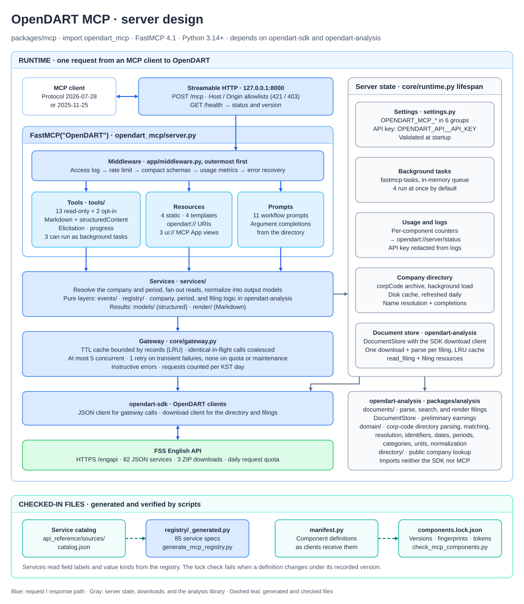

# OpenDART MCP

[](https://github.com/orestxherija/opendart/actions/workflows/ci.yml?query=branch%3Amain)
[](https://codecov.io/github/orestxherija/opendart)

[](https://github.com/astral-sh/ruff)
[](https://pyrefly.org/)

[](https://codecov.io/github/orestxherija/opendart)

A local [Model Context Protocol](https://modelcontextprotocol.io/) server for the regulatory filings of Korean
companies, served over Streamable HTTP on the loopback interface. It is built on [FastMCP](https://gofastmcp.com/) and
reads [OpenDART](https://opendart.fss.or.kr/) through the async `OpenDart` client from `opendart-sdk`. Thirteen
read-only tools answer analyst questions: company identity, filings and their original documents, financial
statements, peer tables, material events, ownership, share capital, debt, dividends, governance, and upcoming corporate
actions. Resources add browsable context, and prompts package multi-step workflows. Every tool accepts a company by
name (English or Korean), stock code, or DART corp code.

## Table of contents

- [Components](#components)
- [Design](#design)
- [Run locally](#run-locally)
- [Configuration](#configuration)
- [Background tasks](#background-tasks)
- [Versions and the component lock](#versions-and-the-component-lock)
- [Smoke test and health route](#smoke-test-and-health-route)
- [Protocol conformance](#protocol-conformance)
- [Connect an MCP client](#connect-an-mcp-client)
- [Docker](#docker)
- [Publish to GHCR](#publish-to-ghcr)

## Components

### Tools

| Tool | What it answers |
| --- | --- |
| `find_company` | Ranked matches in the DART company directory, to confirm an identity or choose among candidates. |
| `get_company_profile` | Names, codes, market, CEO, industry, fiscal year end, contacts, and the latest periodic report. |
| `search_filings` | What was filed, for one company or market-wide, by category, date window, and title text. |
| `read_filing` | The outline, sections, and text search of an original filing; Korean text with the filing's English headings. |
| `get_financials` | Statements, summaries with derived margins, ratios, equity investments, and preliminary earnings. |
| `compare_companies` | A peer table of key accounts or ratios for up to 20 companies. |
| `get_corporate_events` | Capital raises, convertible debt, buybacks, M&A, asset deals, distress, legal events, and overseas listings. |
| `get_ownership` | Largest shareholders, control changes, 5% holder and insider reports, and a free-float estimate. |
| `get_capital_structure` | Share counts, treasury stock, capital changes, and the use of raised funds. |
| `get_debt_profile` | A maturity ladder of debt securities and the issuance record. |
| `get_dividends` | Dividends per share, payout, and yields as filed, across fiscal years. |
| `get_governance` | Auditor and opinion, board, executives, compensation, and employees, with red flags. |
| `get_corporate_action_calendar` | Upcoming subscription, record, meeting, listing, conversion, and maturity dates for up to 20 companies. |

Every tool is annotated read-only, declares a version, and returns Markdown text plus `structuredContent` that matches
its `outputSchema`, with null fields omitted. `response_format="detailed"` adds every labeled field where a tool offers
it. An ambiguous company name returns the candidates with their codes; hosts that support elicitation are asked to
choose instead. "No data" from OpenDART is an empty result with a note, not an error. `read_filing`,
`get_corporate_events`, and `get_corporate_action_calendar` can run as [background tasks](#background-tasks).

Two escape hatches, `list_services` and `call_service`, search all 85 OpenDART services and call one with labeled,
normalized output. They are off by default; set `OPENDART_MCP_TOOLS__ENABLE_SERVICE_TOOLS=true` to register them.

### Resources

| URI | Type | Content |
| --- | --- | --- |
| `opendart://company/{corp_code}` | JSON | The `get_company_profile` payload. |
| `opendart://company/{corp_code}/filings{?since,category}` | JSON | The company's filing index; 90 days and every category by default. |
| `opendart://filing/{filing_number}` | JSON | Filing metadata and its section outline. |
| `opendart://filing/{filing_number}/sections/{section_id}` | Markdown | One rendered section, unpaged. |
| `opendart://reference/vocabulary` | Markdown | Periods, markets, units, dates, categories, and limitations such as the absence of prices. |
| `opendart://reference/filing-categories` | JSON | Filing category names and their upstream codes. |
| `opendart://reference/event-kinds` | JSON | Event groups and kinds with their services, key terms, and date fields. |
| `opendart://server/status` | JSON | Version, key configured, directory state, requests today, cache statistics, and per-component usage. |

### Prompts

| Prompt | Arguments | Workflow |
| --- | --- | --- |
| `company_briefing` | `company` | One-page brief with a list of what to watch. |
| `earnings_review` | `company`, `fiscal_year`, `period` | Statements for a period with year-on-year and quarter-on-quarter changes. |
| `event_impact` | `company`, `event`, `filing_number` | Terms, dilution or leverage effect, and dates of one event. |
| `dilution_overhang` | `company`, `lookback`, `share_price` | Potential new shares from convertibles, warrants, rights issues, and disposals. |
| `ownership_and_control` | `company` | Control snapshot, holder activity, free float, and control risk. |
| `credit_and_liquidity` | `company` | Debt ladder, issuance, cash flow, distress signals, and refinancing risk. |
| `peer_comparison` | `companies`, `fiscal_year`, `focus` | Ranked peer table with commentary on outliers. |
| `filings_screen` | `since`, `market`, `focus` | Market-wide filings screen, prioritized by tradable events. |
| `pre_trade_checklist` | `company`, `direction`, `horizon` | Pass or flag checklist for a trade horizon. |
| `watchlist_digest` | `companies`, `since` | New filings and events per company, items needing action first. |
| `summarize_filing` | `filing_number`, `focus` | English summary of a Korean filing with key numbers and section IDs. |

Company, corp code, and vocabulary arguments of prompts and resource templates complete from the loaded company
directory and the server's code tables. `get_financials`, `compare_companies`, and
`get_corporate_action_calendar` link to interactive [MCP Apps](https://modelcontextprotocol.io/extensions/apps/overview)
(`ui://opendart/financials.v1.html`, `peers.v1.html`, and `calendar.v1.html`): self-contained HTML views with sorting,
filters, and view switches for hosts that render apps. Other hosts get the same text and structured results.

## Design



MCP clients connect to `/mcp` over Streamable HTTP in either protocol era: 2026-07-28 discovery or the 2025-11-25
initialize handshake. Each request passes through access logging, rate limiting, usage metrics, and error recovery,
then reaches a component. Components call services, which resolve the company and the period and read OpenDART through
one shared gateway.

- **Results**: tools return compact Markdown tables as text and the typed result as `structuredContent`. Some hosts,
  Claude Code among them, give the model the structured JSON instead of the text, so concise results stay small.
  Amounts are integers in won; `unit` scales only the text, and never ratios, per-share amounts, or share counts.
- **Errors are instructions**: an ambiguous name lists candidates, an unknown company points to `find_company`, a
  missing key explains how to configure one, and an exhausted quota says when to retry. Unexpected failures are masked
  and logged.
- **Upstream access**: the gateway caches responses by method and arguments, coalesces identical calls, sends at most
  five requests at once, retries a transient failure once (never quota or maintenance errors), and counts requests per
  KST day.
- **Company directory**: the corporation-code archive loads in the background, from a disk cache that is refreshed
  daily. Corp codes work while it loads.
- **Slow calls** report progress at least every five seconds and stop waiting at a deadline while the work continues,
  so repeating the call a minute later returns the cached result.

[IMPLEMENTATION_PLAN.md](docs/IMPLEMENTATION_PLAN.md) records the architecture and decisions,
[COMPONENT_DESIGN.md](docs/COMPONENT_DESIGN.md) specifies each component, and [FILING_DOCUMENTS.md](docs/FILING_DOCUMENTS.md)
covers filing documents. Edit the [draw.io source](docs/architecture.drawio), then export it as SVG to update
[the README diagram](docs/architecture.svg). Keep the source and SVG together.

## Run locally

From the repository root:

```sh
uv sync --locked --all-packages
uv run --no-sync opendart-mcp
```

`uv run --no-sync python -m opendart_mcp.server` is equivalent. The server listens at
`http://127.0.0.1:8000/mcp` until you stop it with Ctrl-C.

Tools read OpenDART with your API key. Set `OPENDART_API__API_KEY` or mount the key file as
`/run/secrets/OPENDART_API__API_KEY`. Without a key the server still starts and lists every component, and tool calls
explain how to configure one. Settings are validated with Pydantic and loaded from the process environment at startup;
`.env` loading stays explicit through direnv or Compose's `--env-file` option. The first start downloads the company
directory, which OpenDART can take minutes to send, and caches it in `~/.cache/opendart-mcp`; until then, tools accept
8-digit corp codes.

The FastMCP CLI loads the server through [`fastmcp.json`](fastmcp.json), for example
`cd packages/mcp && uv run --no-sync fastmcp inspect fastmcp.json`. `fastmcp run` skips `main()`, and with it the
server's Host and Origin allowlists, so serve clients with `opendart-mcp`.

## Configuration

Settings come from `OPENDART_MCP_*` environment variables; nested groups use a double underscore.

| Variable | Default | Meaning |
| --- | --- | --- |
| `OPENDART_API__API_KEY` | none | OpenDART API key, read by the SDK; or the file `/run/secrets/OPENDART_API__API_KEY`. |
| `OPENDART_MCP_HTTP__HOST` | `127.0.0.1` | Bind address: `127.0.0.1`, `localhost`, or `0.0.0.0` inside containers. |
| `OPENDART_MCP_HTTP__PORT` | `8000` | Listener port. |
| `OPENDART_MCP_HTTP__CACHE_TTL` | `300` | Seconds that 2026-07-28 clients may cache lists and reads, with private scope. |
| `OPENDART_MCP_HTTP__LIST_PAGE_SIZE` | none | Page size of component lists; unset returns every component in one page. |
| `OPENDART_MCP_HTTP__RATE_LIMIT` | `20` | Requests per second across all clients. |
| `OPENDART_MCP_HTTP__RATE_BURST` | `50` | Requests allowed in a burst above the rate. |
| `OPENDART_MCP_TASKS__CONCURRENCY` | `4` | Background tasks running at once; more are queued. |
| `OPENDART_MCP_TASKS__QUEUE` | `opendart` | Task queue name. |
| `OPENDART_MCP_TOOLS__ENABLE_SERVICE_TOOLS` | `false` | Register the `list_services` and `call_service` escape hatches. |
| `OPENDART_MCP_TOOLS__ELICIT_AMBIGUOUS_COMPANY` | `true` | Ask hosts that support elicitation to choose among matching companies. |
| `OPENDART_MCP_UPSTREAM__TIMEOUT` | `30` | Read, write, and pool timeout of JSON services, in seconds. |
| `OPENDART_MCP_UPSTREAM__CONNECT_TIMEOUT` | `10` | Connection timeout, in seconds. |
| `OPENDART_MCP_UPSTREAM__MAX_CONCURRENCY` | `5` | Simultaneous OpenDART requests. |
| `OPENDART_MCP_UPSTREAM__RETRY_DELAY` | `1` | Seconds before the single retry of a transient failure. |
| `OPENDART_MCP_UPSTREAM__CACHE_RECORDS` | `50000` | Response cache bound, in upstream records. |
| `OPENDART_MCP_DIRECTORY__CACHE_DIR` | `~/.cache/opendart-mcp` | Company directory cache; follows `XDG_CACHE_HOME`, and is `/tmp/opendart-mcp` in the image. |
| `OPENDART_MCP_DIRECTORY__MAX_AGE_HOURS` | `24` | Age after which the directory is downloaded again. |
| `OPENDART_MCP_DIRECTORY__DEADLINE` | `900` | Overall directory download deadline, in seconds. |
| `OPENDART_MCP_DIRECTORY__WAIT` | `15` | Seconds a tool waits for a loading directory before answering that it is loading. |
| `OPENDART_MCP_DOCUMENTS__TIMEOUT` | `90` | Per-phase filing download timeout, in seconds. |
| `OPENDART_MCP_DOCUMENTS__CONNECT_TIMEOUT` | `10` | Filing download connection timeout, in seconds. |
| `OPENDART_MCP_DOCUMENTS__WAIT` | `45` | Seconds a call waits for a filing download before answering that it continues. |
| `OPENDART_MCP_DOCUMENTS__CACHE_CHARS` | `4000000` | Bound of the rendered-document cache, in characters. |

Misspelled variables within a group are rejected at startup. To turn off a setting whose default is a value, use the
group's JSON form, which merges with the variables above: `OPENDART_MCP_HTTP='{"rate_limit": null}'` disables rate
limiting, and `OPENDART_MCP_DIRECTORY='{"cache_dir": null}'` disables the directory's disk cache.

## Background tasks

`read_filing`, `get_corporate_events`, and `get_corporate_action_calendar` support the MCP tasks extension in optional
mode. A client that declares the extension on a 2026-07-28 connection receives a task at once and polls it; the task's
status message follows the tool's progress. Tasks run in the server process, four at a time by default, and their
results stay available for 15 minutes. Every other client, including handshake-era clients and hosts without the
extension, runs the same tools synchronously and receives progress notifications.

These tools enforce their own deadlines: about 40 seconds in the foreground, which stays under common client request
timeouts, and 110 seconds as a task. At the deadline the call answers that the work is still in progress while the work
continues into the cache, so the same call a minute later returns the result. Tasks do not survive a restart; clients
then receive "task not found" and call again.

## Versions and the component lock

Every tool, resource, template, and prompt declares `version="MAJOR.MINOR.PATCH"`. FastMCP publishes it as
`_meta.fastmcp.version`, and clients can pin it by sending `"_meta": {"fastmcp": {"version": "1.0.0"}}` with a request.
[`components.lock.json`](components.lock.json) records each definition exactly as clients receive it, with its SHA-256,
a hash of each top-level part, and token estimates. `scripts/check_mcp_components.py` compares the server with the lock
and fails when:

- a component declares no version, or one that is not `MAJOR.MINOR.PATCH`;
- a definition changed under a recorded version (the message suggests the smallest acceptable version);
- a new version is a smaller bump than its changes need, compared with the previous recorded version;
- a component or a pinnable older version disappeared, a component was added, or the server's name, version, or
  instructions changed, and the lock was not updated;
- the default tools' model-visible definitions (name, title, description, and input schema) exceed an estimated 10,000
  tokens.

| Change | Bump |
| --- | --- |
| Input schema: removed or renamed property, newly required property, removed type or enum value, tighter bound, new or changed pattern or format | MAJOR |
| Output schema: removed property or changed type | MAJOR |
| Removed or newly required prompt argument, changed MIME type, or a tool that starts requiring tasks | MAJOR |
| Other schema changes, such as a new optional property, wider types or values, a changed input default, or output enum values | MINOR |
| Descriptions, titles, annotations, icons, or `_meta` only | PATCH |

After an intended change, bump `version=` on the component, record the new definitions, and commit the lock:

```sh
just mcp lock                   # scripts/check_mcp_components.py --update
just mcp lock --accept-changes  # after review, also record changes the rules refuse; writes the first lock
```

`--update` records new, removed, and properly bumped components, and refuses missing versions, an exceeded token
budget, changes under recorded versions or with short bumps, and a missing or unreadable lock. `--accept-changes`
records all but the first two, for example when a FastMCP or Pydantic upgrade changes generated schemas while
components stay the same; review the lock diff, which shows every definition change. Without a lock, every component
looks new, so `--update` cannot tell reviewed changes from unreviewed ones: the first lock needs
`just mcp lock --accept-changes`. When the lock has merge conflicts, take either side's lock whole
(`git checkout --theirs -- packages/mcp/components.lock.json`, or `--ours`) and run `just mcp lock`, which records the
other side's version bumps on top of it. The check runs as a commit hook when MCP source or the lock changes (about
a second), and in CI. `--tokens` lists each tool's estimated model-visible tokens. At runtime,
`opendart_mcp.manifest.build_manifest` and `component_fingerprints` produce the same hashes.

## Smoke test and health route

`GET /health` answers with the status and version, such as `{"status": "ok", "version": "0.1.0"}`, without spending a
tool slot. The smoke test checks a running server over real HTTP:

```sh
uv run --no-sync python scripts/check_mcp.py --url http://127.0.0.1:8000/mcp
```

It requires hostile Host and Origin headers to be rejected with 421 and 403, `/health` to answer, both protocol eras
to list every default tool recorded in the lock, the vocabulary resource to be readable, and `find_company` to answer
or to explain what is missing: an API key, or a company directory that is still loading. Without `--url`, it starts an
isolated native server on an unused loopback port and stops it afterward; CI runs it that way.

## Protocol conformance

`just mcp conformance` runs the pinned [official MCP conformance suite](https://github.com/modelcontextprotocol/conformance)
(it needs Node.js) against an isolated server without an API key, at the suite's default wires and again at 2026-07-28.
`packages/mcp/conformance-baseline.yaml` lists the expected failures check by check, each with its reason: the suite's
fixture components (`test://` resources, `test_prompt_*`, `slow_compute`, and so on), features this server does not
offer, and one MCP SDK leniency. Any other failure, or a listed check that passes, fails the run; results are written
to `.cache/conformance/`.

## Connect an MCP client

Start the native server or container first, then configure an MCP client that
supports Streamable HTTP to connect to `http://127.0.0.1:8000/mcp`. The repository-root
[`.mcp.json`](../../.mcp.json) provides this project connection for clients using
the `mcpServers` format with HTTP entries:

```json
{
  "mcpServers": {
    "opendart": {
      "type": "http",
      "url": "http://127.0.0.1:8000/mcp"
    }
  }
}
```

The server runs independently of the client. Multiple local clients can connect
to the same running service. Update the URL in `.mcp.json` if you changed the
default port.

## Docker

From the repository root, after `docker login dhi.io` (the Python base images come from Docker Hardened Images):

```sh
docker compose -f packages/mcp/docker-compose.yml build mcp
docker compose -f packages/mcp/docker-compose.yml up --detach --wait mcp
uv run --no-sync python scripts/check_mcp.py --url http://127.0.0.1:8000/mcp
```

The [container guide](docs/CONTAINER.md) covers DHI credentials, the hardened Compose service, passing the API key
as a secret, memory limits, image metadata, and publishing.

## Publish to GHCR

CI publishes the image to `ghcr.io/orestxherija/opendart-mcp` when a push to `main` changes its inputs and passes
every selected check. The **Publish MCP image** workflow tests, scans, and signs one candidate, then promotes that
digest to `main` and `sha-<full-commit>`; a `vX.Y.Z` release tag promotes the tagged commit's digest. Pin
deployments to the digest:

```sh
docker pull ghcr.io/orestxherija/opendart-mcp@sha256:YOUR_DIGEST
```

See [Publish to GHCR](docs/CONTAINER.md#publish-to-ghcr) in the container guide for tags, pinning, signature
verification, and manual republishing.
