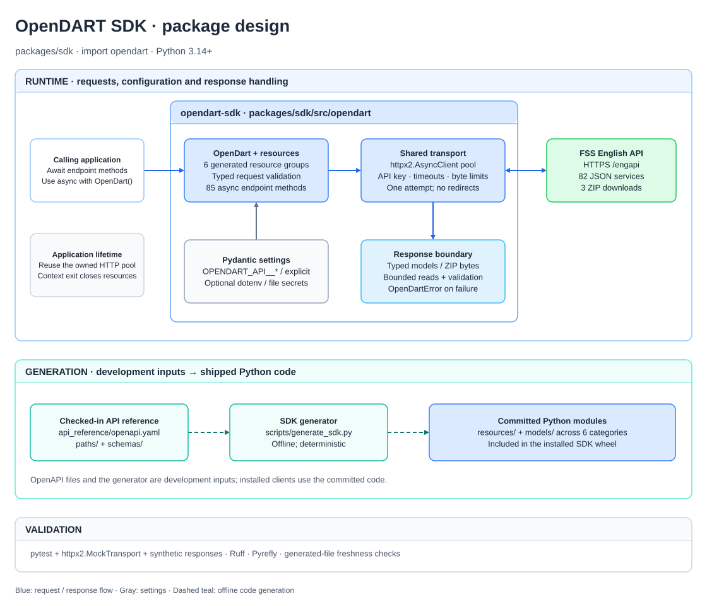

# OpenDART SDK

[](https://github.com/orestxherija/opendart/actions/workflows/ci.yml?query=branch%3Amain)
[](https://codecov.io/github/orestxherija/opendart)

[](https://github.com/astral-sh/ruff)
[](https://mypy.readthedocs.io/)

[](https://codecov.io/github/orestxherija/opendart)

Typed asynchronous Python client for the English OpenDART service
at `https://engopendart.fss.or.kr/engapi`. Requires Python 3.14+.

## Table of contents

- [Design](#design)
- [Use the client](#use-the-client)
- [Financial statements](#financial-statements)
- [Services and models](#services-and-models)
- [ZIP downloads](#zip-downloads)
- [Failures and requests](#failures-and-requests)

## Design



The six generated resource groups share one async HTTP transport. Settings are
validated before use, and responses become typed models, ZIP bytes, or SDK errors.
The checked-in OpenAPI reference generates the resource methods and models offline.

Edit the [draw.io source](docs/architecture.drawio), then export it as SVG to
update [the README diagram](docs/architecture.svg). Keep the source and SVG together.

## Use the client

From a checkout, run `uv sync --locked --all-packages`. The package can also be
installed directly with `python -m pip install ./packages/sdk` from the repository root.
Its distribution name is `opendart-sdk` and its import name is `opendart`.

```python
import asyncio
from getpass import getpass
from pydantic import SecretStr
from opendart import OpenDart, OpenDartSettings


async def main():
    settings = OpenDartSettings(api_key=SecretStr(getpass("OpenDART API key: ")))
    async with OpenDart(settings) as client:
        company = await client.disclosures.company(corporation_code="00126380")
        print(company.corporation_name)


asyncio.run(main())
```

Alternatively, set `OPENDART_API__API_KEY` in the environment and construct
`OpenDart()` without arguments. Environment overrides such as
`OPENDART_API__TIMEOUT=15` and `OPENDART_API__MAX_RESPONSE_BYTES=33554432`
are validated when settings load. Groups are immutable. After deliberately
changing environment variables in a long-running process, call
`get_settings.cache_clear()` before creating another client.

To load a dotenv file explicitly:

```python
import asyncio
from opendart import OpenDart, Settings


async def main():
    settings = Settings(_env_file=".env")
    async with OpenDart(settings.api) as client:
        company = await client.disclosures.company(corporation_code="00126380")
        print(company.corporation_name)


asyncio.run(main())
```

Environment variables override dotenv values. The library does not load a TOML
configuration file or create clients during import.

Container deployments can mount a key file at `/run/secrets/OPENDART_API__API_KEY`.
The root settings model reads this file into `api.api_key`, validates it, and masks
it as `SecretStr`. Explicit arguments, environment variables, and explicit dotenv
values override file secrets. An absent secret directory is allowed; authenticated
clients still require a valid key. For another directory, construct
`Settings(_secrets_dir="/path/to/secrets")` and pass `settings.api` to the client.

## Financial statements

```python
import asyncio
from opendart import OpenDart


async def main():
    async with OpenDart() as client:
        accounts = await client.financial_statements.fnltt_singl_acnt(
            corporation_code="00126380",
            fiscal_year="2025",
            report_period="11011",
        )
        for account in accounts.list or []:
            print(account.account_name, account.current_period_amount)


asyncio.run(main())
```

`OpenDart` is asynchronous. Await every endpoint call and use `async with` or
`await client.aclose()` to close its reusable HTTP pool. Keep the client for the
calling application's lifetime and on its owning event loop.

## Services and models

| Resource | Services |
| --- | ---: |
| `client.disclosures` | 4 |
| `client.periodic_reports` | 30 |
| `client.financial_statements` | 7 |
| `client.equity_disclosures` | 2 |
| `client.major_issues` | 36 |
| `client.securities_registration` | 6 |

Methods use the upstream route's name in snake case, such as
`fnltt_singl_acnt`, `stock_totqy_sttus`, or `estk_rs`. The two descriptive names
are `disclosures.search` for `/list.json` and `disclosures.corporation_codes`
for `/corpCode.xml`. Each method has explicit keyword arguments, a typed return,
and a docstring linking to its official endpoint guide. Every endpoint method is
asynchronous.

Method arguments and request model attributes use descriptive Python names.
OpenDART still receives its documented query keys; for example,
`disclosure_category="A"` is sent as `pblntf_ty=A`. The codes and string formats
remain the upstream values. These are the query-name translations:

| Python name | OpenDART query key |
| --- | --- |
| `corporation_code` | `corp_code` |
| `corporation_codes` (batch methods) | `corp_code` |
| `corporation_type` | `corp_cls` |
| `filing_start_date` / `filing_end_date` | `bgn_de` / `end_de` |
| `filing_number` | `rcept_no` |
| `fiscal_year` | `bsns_year` |
| `report_period` | `reprt_code` |
| `statement_scope` / `statement_type` | `fs_div` / `sj_div` |
| `indicator_category_code` | `idx_cl_code` |
| `disclosure_category` / `disclosure_subcategory` | `pblntf_ty` / `pblntf_detail_ty` |
| `final_reports_only` | `last_reprt_at` |
| `sort_by` / `sort_order` | `sort` / `sort_mth` |
| `page_number` / `page_size` | `page_no` / `page_count` |

Response models also give common fields readable names, such as
`filing_number`, `corporation_name`, `report_title`, and
`current_period_amount`. Use `model_dump(by_alias=True)` when you need the
original OpenDART field names.

Request, response, and nested record models live together in category modules,
such as `opendart.models.disclosures` and `opendart.models.financial_statements`.
For example, `opendart.models.disclosures` contains `ListRequest`, `ListResponse`,
and `ListResponseListItem`. Request and response models are also re-exported from
`opendart.models`. Generated files are committed, so installing the SDK does not
require the OpenAPI files, PyYAML, or a code generator.

Identifiers, years, dates, and financial values remain strings. Methods validate
identifier shapes, enums, pagination bounds, and the 1–100-code batch limit before
sending a request. Multi-company inputs use a list of corporation codes:

```python
import asyncio
from opendart import OpenDart


async def main():
    async with OpenDart() as client:
        accounts = await client.financial_statements.fnltt_multi_acnt(
            corporation_codes=["00126380", "00164779"],
            fiscal_year="2025",
            report_period="11011",
        )
        print(accounts.list)


asyncio.run(main())
```

Financial values retain commas, blanks, and `-`. Only `status` and `message`
are required in successful envelopes; other fields may be `None`. This is SDK
tolerance for missing/null values, not a guarantee about the upstream's behavior.
New upstream fields are preserved in `model_extra` and `model_dump()`.
Nested remuneration and securities-registration sections have endpoint-specific
models. Disclosure search returns one page; advance `page_number` explicitly using
the response's `total_page`. Without a corporation code, the upstream limits
search intervals to three months.

## ZIP downloads

```python
import asyncio
from pathlib import Path
from opendart import OpenDart


async def main():
    async with OpenDart() as client:
        archive = await client.disclosures.corporation_codes()
        await asyncio.to_thread(Path("corporations.zip").write_bytes, archive)


asyncio.run(main())
```

`disclosures.document(filing_number=...)` and
`financial_statements.fnltt_xbrl(filing_number=..., report_period=...)` also return ZIP
bytes. The `.xml` route suffix does not determine the successful response format.
XML error envelopes on these routes raise the same SDK errors as JSON services.
The SDK validates the ZIP container without extracting archive members.

Bodies are read incrementally and bounded by `max_response_bytes` (32 MiB by
default) or `max_download_bytes` (128 MiB). Returned models/bytes are buffered
within those budgets; this is not a streaming iterator API. Downloads remain
compressed ZIP bytes; extraction and any expanded-size limits belong to the caller.
The SDK requests identity content encoding and rejects HTTP-compressed responses
before consuming their bodies. Actual bytes, rather than `Content-Length`, enforce
the budget. The response closes on success, failures, size-limit errors, and async
cancellation.

## Failures and requests

```python
import asyncio
from opendart import OpenDart, NoDataError, QuotaExceededError


async def main():
    async with OpenDart() as client:
        try:
            page = await client.disclosures.search(corporation_code="00126380")
            print(page.total_count)
        except NoDataError:
            print("No matching filings")
        except QuotaExceededError:
            print("The API key's configured quota is exhausted")


asyncio.run(main())
```

| Failure | Exception |
| --- | --- |
| API `013` / `014` | `NoDataError` / `FileUnavailableError` |
| API `020` / `800` | `QuotaExceededError` / `ServiceUnavailableError` (also `UnavailableError`) |
| API credential/parameter/permission rejection | `APIRejectedError` (also `RejectedError`) |
| Other or future non-success API codes | `APIError` |
| HTTP 429/5xx or transport failure | `UnavailableError` |
| Other HTTP 4xx | `RejectedError` |
| Unexpected response, encoding, or redirect | `ContractError` |
| Response byte limit exceeded | `ResponseTooLargeError` (also `ContractError`) |
| Invalid caller input | Pydantic `ValidationError` |

All SDK failures inherit `OpenDartError` and expose `operation`, `status` (the
application code, if present), and `http_status` (if relevant). Unknown three-digit
API failure codes remain errors. Cancellation and programming errors propagate.

The client makes one attempt per call and does not follow redirects. It enables
TLS verification. Phase timeouts default to five seconds, with a separate
`connect_timeout`; they do not impose a total operation deadline. Async callers
can wrap a complete operation in `asyncio.timeout(...)`. Quotas and reset times
are not assumed, and the SDK does not retry quota failures.

FSS requires the API key in the `crtfc_key` query parameter, so every request URL
carries it. The SDK keeps the key out of logs and exceptions without configuration:

- Creating a client attaches `opendart.redaction.RedactSecrets` to the httpx2 and
  httpcore2 loggers, so request logs read `crtfc_key=[REDACTED]` at any level. The
  filter is added once; logger levels, handlers, and other filters are left alone.
- SDK exception messages exclude keys, URLs, and upstream diagnostic text. Chained
  causes keep their type, but the key is redacted from their messages, notes, and
  `request.url`; a cause whose text would still show the key is dropped. Response
  model validation errors omit input values, so echoed bodies stay out of causes.
- Other failures leaving an endpoint call, such as a custom transport's errors, are
  redacted in place and re-raised unchanged in type.

`opendart.redaction` also provides `redact` and `RedactingFormatter` for handlers
that may render URLs from other sources. Tools that capture frame locals, such as
error trackers or tracebacks with locals, can still see the outgoing request inside
HTTP-library frames; configure their scrubbing for `crtfc_key`.

Tests inject `httpx2.MockTransport` through the client's `transport=` argument.
A custom production transport owns its own TLS, proxy, and pool configuration.
The test suite uses synthetic responses and makes no authenticated API calls;
the checked-in API reference's documented uncertainties still apply.

Development, regeneration, and validation commands are in the repository README.
